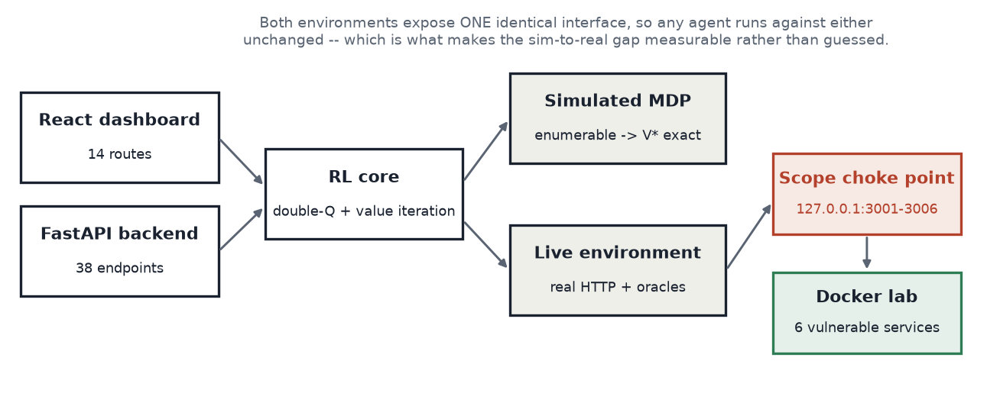
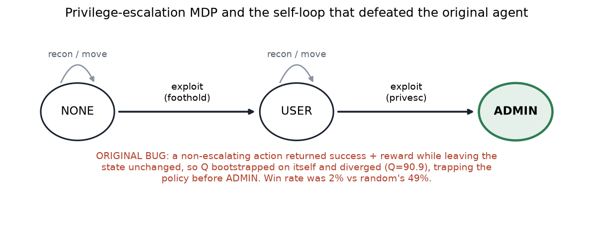
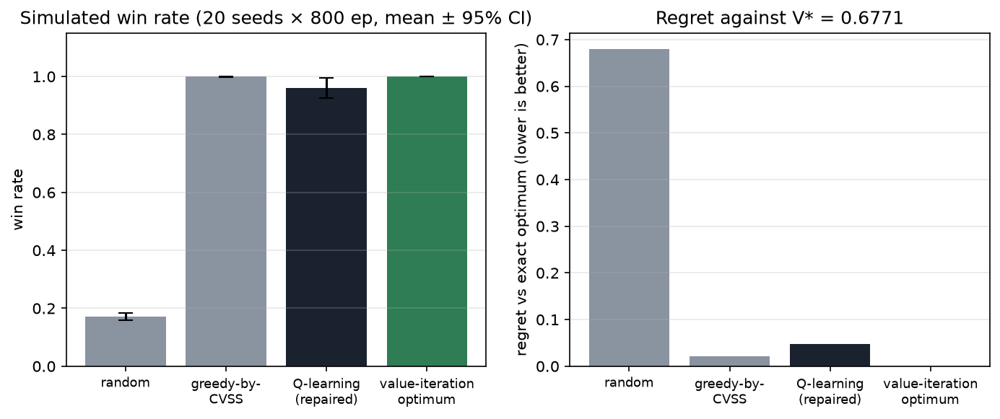
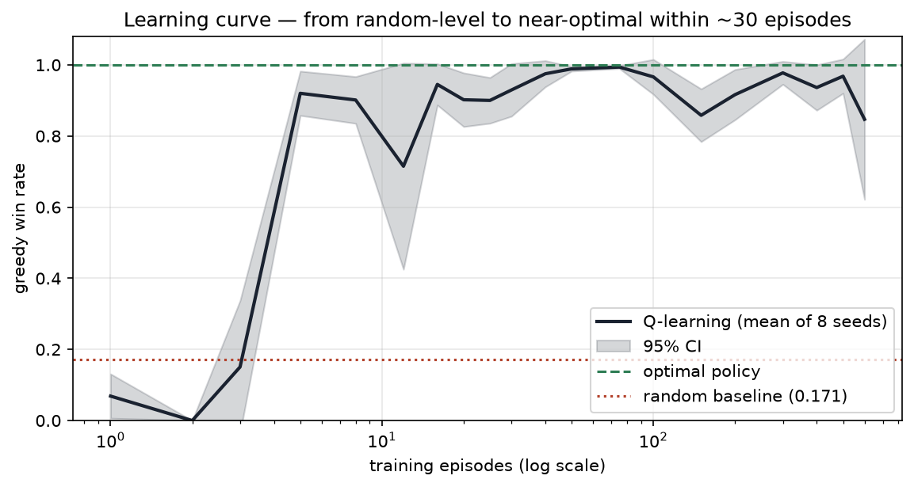
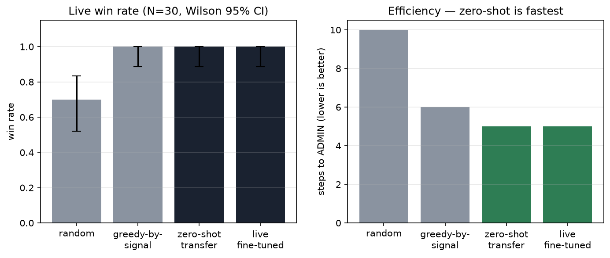
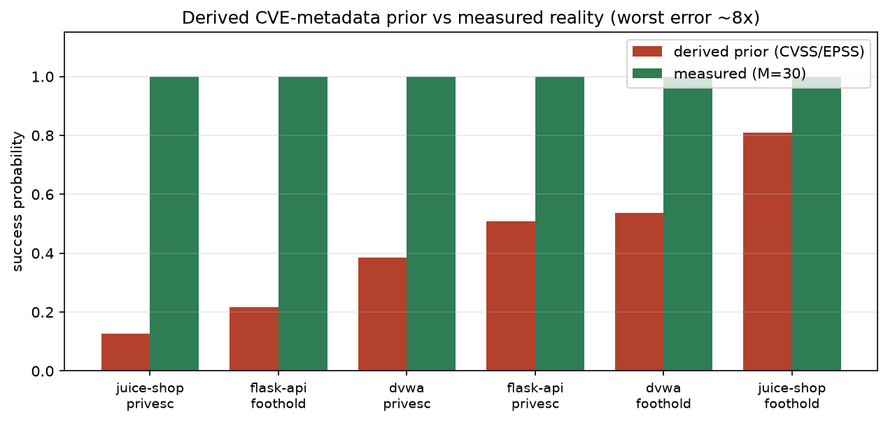
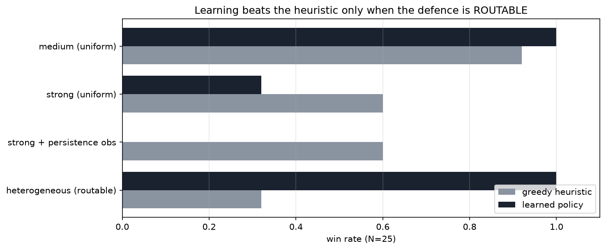
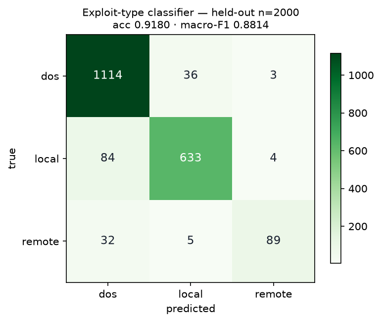

# ART-AI — detailed component summary

Every feature in the project: what it is, whether it works, its **measured** number (or
an explicit "not measured"), and where it sits in the research literature.

Rule applied throughout: **no number appears here that was not generated by a run.**
Where a component has no meaningful accuracy metric (a scanner is not a classifier), that
is said plainly rather than invented.

> **Figures.** All charts are regenerated by `python paper/make_figures.py` into
> `paper/figures/`. An executable Colab notebook with the same analysis is at
> `paper/ART_AI_Results.ipynb`.

### System architecture



The design decision that makes the research possible: the **simulated MDP** and the **live
environment** expose one identical interface, so any agent runs against either unchanged —
which is what makes the sim-to-real gap *measurable* rather than guessed. All live traffic
passes a single allow-listed choke point.

---

## Part 1 — Reinforcement-learning core (the research contribution)

### 1.1 Simulated attack MDP
**What it is.** A fully-specified, enumerable Markov decision process abstracting the lab.
State = `(access, position, discovered-hosts)`; actions = `recon`, `exploit`, `move_i`;
reward = −0.01 per step, +1.0 on reaching ADMIN; discount 0.95. 72 states.

**Why it matters.** Because the kernel is explicit, the **exact optimum is computable by
value iteration** — so every agent is scored as regret against a true ceiling, not against
another heuristic. Most papers in this area have no such ceiling.

| metric | value |
|---|---|
| Value-iteration optimum V\* | **0.6772** |
| Learned agent win rate (20 seeds × 800 ep) | **0.960 ± 0.035** |
| Fraction of optimum achieved | **93%** (regret 0.047) |
| Random baseline | 0.171 ± 0.012 |
| Greedy-by-CVSS baseline | 0.999 ± 0.001 |
| Q-table size | 59.95 ± 1.77 states (was 9) |
| **Before repair** | **2% win — lost to random's 49%** |

**Fits:** Sutton & Barto (tabular Q-learning, value iteration); van Hasselt (double-Q).
Comparable in spirit to **NASim** and **CyberBattleSim** as a simulated pentest MDP, but
smaller and with an exact optimum they lack.







The learning curve is on a log x-axis because the agent climbs from random-level to
near-optimal **within roughly 30 episodes** — a linear axis hides the entire transition.


### 1.2 Ablation study
**What it is.** Each technique toggled independently, 20 seeds, reported with CIs.

| configuration | win rate | regret | episodes to 80% |
|---|---|---|---|
| default (double-Q + replay) | 0.960 ± 0.035 | 0.047 | 36.3 ± 8.0 |
| double-Q off | 0.976 ± 0.029 | 0.031 | 28.8 ± 5.7 |
| replay off | 0.973 ± 0.033 | 0.036 | **73.8 ± 22.9** |
| Boltzmann vs ε-greedy | 0.973 ± 0.027 | 0.028 | 33.8 ± 8.7 |
| hint on | 0.978 ± 0.027 | 0.034 | 30.0 ± 6.1 |

**Honest finding:** only **experience replay** shows a defensible benefit — removing it
roughly doubles episodes-to-competence (intervals do not overlap). Double-Q, Boltzmann and
the hint are all within overlapping intervals: **not justified by a measured improvement**,
and we say so rather than asserting they help.

### 1.3 Live attack environment
**What it is.** An environment interface-compatible with the simulator, where every
`exploit` issues a **real HTTP request** and escalates only on a deterministic oracle
verdict backed by a logged response. `transitions()` deliberately raises — a live
environment has no enumerable kernel.

| metric | value |
|---|---|
| Hosts with working oracles | **6 / 6** (12 capabilities) |
| Real HTTP requests per full run | **2,126** (14.7 / episode, 224 s) |
| Oracle verdicts logged | 276 True, 0 fabricated |
| `rng` calls on the live path | **0** (mechanically verified) |

**Fits:** this is the **PenGym** / **GAP** / **CRLF** line (real execution rather than
simulation). Those came first; see §5 for honest positioning.

### 1.4 Sim-to-real transfer
| configuration | win rate (N=30) | Wilson 95% CI | steps |
|---|---|---|---|
| random | 0.700 | [0.521, 0.833] | 10.00 |
| greedy-by-signal | 1.000 | [0.886, 1.000] | 6.00 |
| **zero-shot transfer** | **1.000** | [0.886, 1.000] | **5.00** |
| live fine-tuned | 1.000 | [0.886, 1.000] | 5.00 |

Sim optimum 0.6772; measured-MDP optimum 0.8740. **Fine-tuning added exactly 0.000** —
reported as a null result.

**Fits:** sim-to-real RL transfer (**GAP**, arXiv 2412.04078; **CRLF**, ESORICS 2025).




---

## Part 2 — The two research findings

### 2.1 CVE-metadata priors are poor per-instance estimators
Each of 12 capability probes run **M = 30** times. Every one measured **1.000**
(Wilson 95% CI [0.886, 1.000]) against CVSS/EPSS-derived priors:

| host · capability | derived prior | measured | error |
|---|---|---|---|
| juice-shop privesc | 0.126 | 1.000 | **7.9×** |
| flask-api foothold | 0.216 | 1.000 | 4.6× |
| dvwa privesc | 0.384 | 1.000 | 2.6× |
| juice-shop foothold | 0.810 | 1.000 | 1.2× |

**Interpretation:** CVSS scores *severity*; EPSS estimates *exploitation attempts in the
wild* — a population statistic. Neither answers "will this exact payload work on this exact
host". We did **not** re-fit the formula to match; that would be curve-fitting to one lab.

**Fits:** the CVSS/EPSS critique literature — **SecScore** (arXiv 2405.08539),
*Conflicting Scores* (arXiv 2508.13644), FIRST's own EPSS FAQ.




### 2.2 The dominant sim-to-real gap was the state abstraction, not the probabilities
First live run: **zero-shot transfer 0.000 while random scored 1.000.** Cause, from one
evidence-log line: the simulator modelled a **global** privilege level, so its optimal
policy took a cheap foothold on one host and escalated on *another*. False here — the six
targets are independent web apps; a Juice Shop token is worthless on DVWA. After modelling
host-local access, transfer became perfect (1.000).

**Significance:** fixing probabilities would not have helped; fixing the abstraction did.
**A simulator cannot validate its own abstractions.** This is the project's most original
observation and is not, as far as the 2024–26 literature shows, directly reported elsewhere.

---

## Part 3 — The complex-lab extension (newest work)

### 3.1 Stochastic defender layer
**What it is.** A real, stateful defender: per-host rate limiting, account lockout after
consecutive failures, and probabilistic filtering. Off by default.

**Honesty invariant:** the defender can only make an attempt **fail** — never fabricates a
success. Verified by a test: a block-all filter can never reach ADMIN.

Greedy win rate across defender strength: **1.000 / 1.000 / 0.900 / 0.600**
(none / mild / medium / strong) — the deterministic lab became genuinely graded.

### 3.2 The decisive experiment — when does learning actually beat a heuristic?

| defender | greedy | learned | delta | verdict |
|---|---|---|---|---|
| medium (uniform) | 0.920 | 1.000 | +0.08 | helps slightly |
| strong (uniform) | 0.600 | 0.320 | −0.28 | **learning hurt** |
| strong + persistence-aware obs | 0.600 | 0.000 | −0.60 | **the "fix" hurt more** |
| **heterogeneous (routable)** | **0.320** | **1.000** | **+0.68** | **learning wins** |

The last row's intervals do not overlap ([0.17, 0.52] vs [0.87, 1.00]) — significant.



Traced winning episode: the learner **reconnoitres all three hosts, skips the two defended
ones, routes to the soft flask-api, and wins in 6 steps**; greedy keeps attacking the
heavily-defended host it meets first.

**The conditional claim this earns:**
> A learned policy beats a CVSS-greedy heuristic **exactly when the defensive posture is
> heterogeneous (routable)** — when there is a soft target to find. Under a **uniform**
> defender, stubborn persistence is optimal, learning does not help, and a mis-designed
> observation makes it actively worse.

**Fits / extends:** the 2026 CAGE red-team finding that *"RL alone collapses to a degenerate
policy under sparse rewards"* (arXiv 2605.17075); the robust-POMDP pentest paper's
"dynamic networks" future work (arXiv 2509.20008); **CybORG/CAGE** (stochastic but
simulated and mostly blue-team).

---

## Part 4 — Supporting systems

### 4.1 Port scanner — rewritten from fabricated to real
**Before:** chose "open" from `hash(target:port) % 100`. Reported ports 25 and 9200 that
were **not listening**, and missed every port that was.
**After:** real concurrent TCP connect + banner grab.
**Accuracy: 8/8 ports, exact match with `netstat`** — zero false positives, zero misses.
Scope guard refuses non-local targets with HTTP 400.

### 4.2 Vulnerability scanner — rewritten from fabricated to evidence-backed
**Before:** a service-name lookup emitting three canned findings with placeholder IDs
(`CVE-2023-XXXXX/YYYYY/ZZZZZ`) for every HTTP port — including the project's own API port,
which it never tested. "Found" was decided by `hash(...) % 100 < p`.
**After:** six detectors issuing real requests; a finding ships only with the evidence that
proved it. **No CVE is ever invented** — findings carry a CWE class, `cve` stays null unless
genuinely known.

**Result: 21 fabricated findings → 7 confirmed.** Ports 3002/3004/3006 now honestly report
zero unauthenticated findings (their injection points need a session).

| port | finding (CWE) | evidence |
|---|---|---|
| 3001 | SQL Injection (CWE-89) | injected request surfaced `SQLITE_ERROR`, benign did not |
| 3001 | Auth Bypass (CWE-89) | token issued for `' OR 1=1--`, no valid password |
| 3003 | SQL Injection (CWE-89) | benign 2 records → injected 8 |
| 3003 | Path Traversal (CWE-22) | response contained `root:x:0:0:` |
| 3003 | Reflected XSS (CWE-79) | marker reflected with tags unencoded |
| 3003 | Default Credentials (CWE-1392) | `admin/admin123` → `role=admin` |
| 3005 | Sensitive Data Exposure (CWE-200) | `/users/v1/_debug` → 83 plaintext passwords |

**Fits:** CWE (MITRE) classification; standard DAST practice of differential/evidence-based
detection.

### 4.3 ML exploit pipeline
**What it is.** A GradientBoosting classifier (exploit type), a PyTorch success-probability
ranker, and a SentenceTransformer (`all-MiniLM-L6-v2`) semantic search over a 10,000-entry
vector store built from an Exploit-DB export.

**Corpus:** 10,000 records, 19 attributes. Classes: dos 5,765 / local 3,603 / remote 632.
Mean CVSS 5.94.

**Measured accuracy** (the shipped pickles recorded *none*; we measured it — see
`experiments/eval_ml_models.py` and `results/ml_eval.json`):

| evaluation | accuracy | macro-F1 | note |
|---|---|---|---|
| majority-class baseline ("always dos") | 0.5765 | 0.2438 | the number any model must beat |
| shipped model, full corpus | 0.9480 | 0.9344 | **optimistic** — effectively a train-set score |
| **fresh model, held-out 20% (n=2,000)** | **0.9180** | **0.8814** | **the honest generalisation number** |

Lift over the majority baseline: **+0.3415 accuracy**. Per class:

| class | precision | recall | F1 | support |
|---|---|---|---|---|
| dos | 0.91 | 0.97 | 0.93 | 1,153 |
| local | 0.94 | 0.88 | 0.91 | 721 |
| **remote** | 0.93 | **0.71** | **0.80** | **126** |



**Honest caveats:** (a) the corpus is heavily imbalanced, so accuracy alone misleads — the
baseline already gets 57.65%; **macro-F1 (0.8814) is the fair metric**. (b) The weak class
is `remote` (recall 0.71, only 632 records in the corpus) — visible as the 32 `remote`
cases misread as `dos`. (c) The **`verified` column is 0 for every record**, so a signal
weighted 0.10 in the grounding formula contributes nothing. (d) The ranker and vector store
have **no measured retrieval accuracy** — not evaluated, and not claimed.

### 4.4 Application layer
FastAPI backend (38 endpoints), React dashboard (14 routes). Verified in a real browser:
**14/14 routes load, 0 console errors, 0 blank pages**, API calls returning 200.
Functional UI tests: 6/6 passed (scan renders real banners, scope guard alerts, code
analysis flags injections, simulation renders the attack path).
**Not a research contribution** — it is the demonstrator.

### 4.5 Vulnerable laboratory
Six deliberately-insecure applications in Docker, all bound to `127.0.0.1`, all
health-checked: Juice Shop (3001), DVWA (3002), custom Flask API (3003), WebGoat (3004),
VAmPI (3005), bWAPP (3006). **6/6 healthy.**

---

## Part 5 — Honest positioning against the literature

**Not novel** (do not claim these):
- RL for penetration testing as a framing — a decade of prior work.
- Tabular Q-learning, double-Q, replay, value iteration — textbook.
- **Agent attacks a real lab with zero-shot transfer** — **GAP** (arXiv 2412.04078, Dec
  2024) did this first with a Real-to-Sim-to-Real pipeline, domain randomization and
  meta-RL; **PenGym** executes real actions on emulated hosts; **CRLF** is an explicit
  Sim2Real pentest environment.
- CVSS/EPSS being weak exploit-likelihood signals — already discussed in the scoring
  literature.

**Defensibly ours:**
1. The **state-abstraction finding** (§2.2) — the dominant transfer gap was the
   abstraction, not the probabilities.
2. The **routability result** (§3.2) — learning beats a heuristic *iff* the defence is
   heterogeneous; under a uniform defender persistence wins. Reached through two documented
   failures and a diagnosis, not by tuning.
3. The **per-step evidence log** — each reward tied to a logged, verifiable observation,
   making "the agent attacked" auditable rather than asserted.
4. The observation-design lesson: an attacker must observe block **persistence**, not mere
   occurrence.

**Honest level:** a strong thesis / workshop-paper contribution — a **testbed and an
empirical study**, not a new algorithm. Framed that way it is defensible; framed as "a novel
RL algorithm for autonomous hacking" it would not survive review.

---

## Part 6 — Verification and reproducibility

| check | status |
|---|---|
| Live test suite | **42 assertions passed, 0 failed, 0 skipped** (5 pytest test functions) |
| Scope guard rejects off-allowlist before socket opens | ✅ (incl. own port 8003, IPv6) |
| Every oracle has a positive AND negative case | ✅ 12 capabilities |
| `rng` cannot influence a live verdict | ✅ asserted by test |
| Defender never fabricates a win | ✅ block-all filter can never reach ADMIN |
| Simulator unchanged by all live work | ✅ `V* = 0.6772` identical, files untouched |
| Deterministic seeds, logged git commit + config | ✅ |

```bash
python -m experiments.run_all          # simulation, 20 seeds
python -m experiments.run_live         # sim-to-real protocol
python -m experiments.run_defender --strengths 4   # the routability result
python -m experiments.eval_ml_models   # ML accuracy
python -m live.tests.test_live         # 42 assertions, per-assertion tally
pytest live/tests/ -q                  # same suite: 5 test functions
```

## Part 7 — Known limitations (state these before a reviewer finds them)

1. Deterministic base lab (p = 1.000 for all 12 probes) — the defender layer was built
   precisely to fix this.
2. Small live N (25–30 episodes); a win rate of 1.000 at N=25 still admits a true rate of
   0.867.
3. The corpus `verified` column is uniformly 0 — one grounding signal is inert.
4. Live learner trained for only 100–120 episodes — undertrained for a ~150-state POMDP.
5. Vulnerability scanning is unauthenticated only; three hosts therefore report zero.
6. LLM chat endpoints are non-functional (no model connected, committed key invalid).
7. A live Gemini API key was hardcoded in `backend/main.py` and committed (introduced in
   `a0a62f5`, removed in `3b05a34`). Both commits are on `main`, so the key is readable in
   public history and **must be revoked**, not merely rotated — removing it from `HEAD`
   does not unpublish it. For the record: `.env` itself was **never** tracked (verified
   with `git log --all -- .env`, which returns nothing); `.env.example` holds placeholders
   only. Recorded as a process failure.
8. Six hosts on one machine is not a network; no adaptive adversary.
